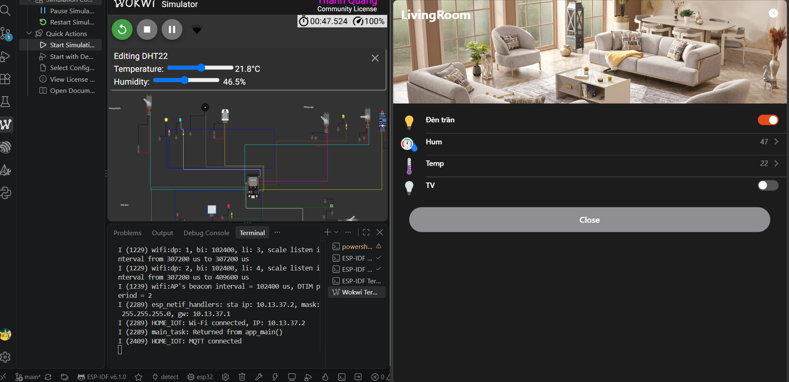
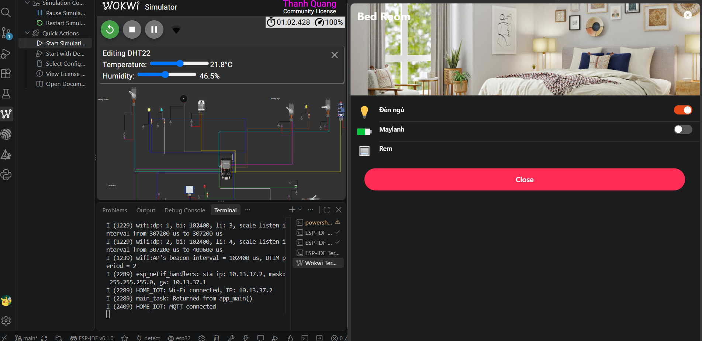

# Smart Home ESP32

Dự án mô phỏng nhà thông minh bằng ESP32 trên Wokwi, điều khiển qua MQTT và
openHAB. Thiết bị gồm đèn, cửa, rèm, điều hòa, quạt, máy bơm, cảm biến DHT22,
PIR, LDR và khoảng cách.

## 1. Cài đặt Wokwi

1. Cài [Visual Studio Code](https://code.visualstudio.com/).
2. Cài extension [Wokwi for VS Code](https://marketplace.visualstudio.com/items?itemName=wokwi.wokwi-vscode).
3. Đăng nhập Wokwi, mở thư mục dự án và chạy mô phỏng từ `diagram.json`.

Tài liệu hướng dẫn: [Wokwi - Getting Started with ESP32](https://docs.wokwi.com/guides/esp32).

## 2. Cài đặt ESP-IDF

Trên Windows, cài [ESP-IDF Tools Installer](https://docs.espressif.com/projects/esp-idf/en/latest/esp32/get-started/windows-setup.html),
chọn ESP-IDF, Python, Git và công cụ biên dịch. Sau đó mở **ESP-IDF PowerShell**.

Kiểm tra và biên dịch:

```powershell
idf.py --version
idf.py set-target esp32
idf.py build
```

Tham khảo: 
[Espressif - Get Started](https://docs.espressif.com/projects/esp-idf/en/latest/esp32/get-started/index.html).
[Wokwi-Esp-idf](https://docs.wokwi.com/vscode/esp-idf)

## 3. MQTT

ESP32 kết nối Wi-Fi `Wokwi-GUEST` và MQTT port `1883`.

| Topic | Ý nghĩa |
|---|---|
| `/emohtrams9191/SMART_HOME` | Nhận lệnh điều khiển và phát trạng thái |
| `/emohtrams9191/temp` | Nhiệt độ (°C) |
| `/emohtrams9191/humidity` | Độ ẩm (%) |

Lệnh trên topic điều khiển:

| Giá trị | Thiết bị |
|---:|---|
| `1` / `-1` | Bật / tắt TV |
| `2` / `-2` | Bật / tắt đèn phòng khách |
| `3` / `-3` | Bật / tắt điều hòa |
| `4` / `-4` | Mở / đóng cửa |
| `5` / `-5` | Bật / tắt đèn phòng ngủ |
| `6` / `-6` | Bật / tắt máy bơm |

Dùng `mqtt://host.wokwi.internal:1883`, chạy MQTT broker qua Wokwi Private Gateway. 

## 4. Cấu hình openHAB

1. Cài openHAB và mở **Settings → Add-ons → Bindings**.
2. Cài **MQTT Binding**, tạo MQTT Broker Thing với host broker và port `1883`.
3. Tạo các MQTT channels/items, dùng topic điều khiển
   `/emohtrams9191/SMART_HOME`; liên kết `temp` và `humidity` với hai topic cảm
   biến tương ứng.
4. Gắn tag semantic cho các item (ví dụ `Lightbulb`, `HVAC`, `Door`, `Pump`,
   `Sensor`) để giao diện và Google Assistant nhận diện đúng.

Các item mẫu đã lưu trong `openHAB/userdata/jsondb`. Local host `127.0.0.1`; 
kiểm tra broker bằng MQTT Explorer hoặc `mosquitto_pub`/`mosquitto_sub`.

Tài liệu: [openHAB MQTT Binding](https://www.openhab.org/addons/bindings/mqtt/).

## 5. Tích hợp Google Assistant

1. Trong openHAB, cài **openHAB Cloud Connector**, đăng ký tài khoản tại
   [myopenHAB](https://my.openhab.org/) và liên kết instance.
2. Bật Google Assistant trong phần **Settings → Other Services** của openHAB
   Cloud, chọn các item cần chia sẻ và kiểm tra semantic tags.
3. Trong ứng dụng Google Home, chọn **Add device → Works with Google → openHAB**,
   đăng nhập myopenHAB và đặt thiết bị vào phòng.
4. Đồng bộ thiết bị bằng lệnh “Hey Google, sync my devices”.

Xem [hướng dẫn Google Assistant của openHAB](https://www.openhab.org/docs/ecosystem/google-assistant/).

## Bắt đầu

```powershell
idf.py build
# Mở mô phỏng bằng Wokwi for VS Code
Start Simulation
# Mở openHAB
start.bat
# Mở google assistant và điều khiển qua giọng nói
# Kiểm tra Wokwi simulation và log phản hồi


```